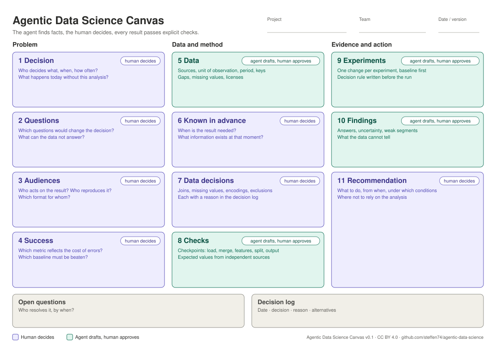

# The Agentic Data Science Canvas

One page, eleven blocks, one log. Fill it from left to right the first time, then revisit any block when something changes.

- Printable: [`agentic-data-science-canvas.pdf`](agentic-data-science-canvas.pdf) (A4 landscape)
- Markdown template for projects: [`CANVAS.md`](../skills/core/setup-ds-project/templates/CANVAS.md) (copied into your repository by `/setup-ds-project`)

**Owners.** 👤 *Human decides*: the agent may recommend, but a person makes and signs the decision. 🤖 *Agent drafts, human approves*: the agent does the legwork; a person checks and accepts it.

---

## Problem

### 1. Decision 👤
**Purpose:** anchor the analysis in a real choice.
**Prompts:** Who decides? What exactly? How often, and how far ahead? What happens today without this analysis? What would change if the answer were known?
**Typical mistakes:** starting from the dataset (“we have sales data, let’s predict sales”) instead of the decision; a decision so vague that no result could change it.
**Filled by:** `/grill-question`

### 2. Questions 👤
**Purpose:** turn the decision into questions data can answer.
**Prompts:** Which questions, if answered, would change the decision? For each: what would the answer look like? What can the data *not* answer?
**Typical mistakes:** questions the data cannot answer (no data under the relevant conditions); confusing association with cause.
**Filled by:** `/grill-question`

### 3. Audiences 👤
**Purpose:** decide who receives what before producing it.
**Prompts:** Who acts on the result, and what do they already know? Who has to reproduce or extend the work? Which format suits each (memo, chart with action title, README, presentation, model card)?
**Typical mistakes:** one output for everyone; technical jargon for a decision-maker; a repository nobody else can run.
**Filled by:** `/grill-question`; used by `/to-memo`

### 4. Success 👤
**Purpose:** fix in advance what counts as good enough.
**Prompts:** Which metric reflects the real cost of errors? Which baseline must be beaten? Are over- and underestimation equally bad? Which segments matter most?
**Typical mistakes:** choosing the metric after seeing results; no baseline; one overall number hiding a segment where the model fails.
**Filled by:** `/grill-question`, `/to-analysis-plan`

---

## Data and method

### 5. Data 🤖
**Purpose:** a factual inventory of what is available.
**Prompts:** Sources, unit of observation, period, keys, granularity. Coverage gaps, missing values, duplicates. Licenses and restrictions. Which data could be added?
**Typical mistakes:** assuming completeness; comparing an incomplete period with full ones; not noticing that a key is not unique.
**Deep learning:** pretrained models, their training data and license; label quality.
**Filled by:** `/explore-data`

### 6. Known in advance 👤
**Purpose:** draw the leakage boundary.
**Prompts:** At what moment is the result needed? Which information exists at that moment? Which only afterwards (same-day values, totals that include the target, observed instead of forecast weather)?
**Typical mistakes:** using information from the future without noticing; random splits on time series.
**Filled by:** `/grill-question`; enforced by the `leakage` skill

### 7. Data decisions 👤
**Purpose:** make every judgement call about the data explicit.
**Prompts:** How are sources joined? How are missing values treated, and why (mechanism)? How are categories encoded? What is excluded?
**Typical mistakes:** imputing values that are missing for a reason; silent row drops; decisions only visible in code.
**Filled by:** `/explore-data` proposes, humans decide; logged in `DECISIONS.md`

### 8. Checks 🤖
**Purpose:** invariants that must hold before any result counts.
**Prompts:** At which checkpoints (load, merge, features, split, predictions, metrics)? What is the expected value, and where does it come from independently of the code?
**Typical mistakes:** checks that recompute the result the same way; loosening a check until it passes; checking only the final number.
**Deep learning:** training sanity checks; split checks for near-duplicates and groups.
**Filled by:** `/to-analysis-plan`, `/implement-experiment`; rules in the `data-checks` skill

---

## Evidence and action

### 9. Experiments 🤖
**Purpose:** a visible record of what was tried and what it showed.
**Prompts:** Which experiment cards exist, in which order? What did each change, and did it beat the previous best on validation data?
**Typical mistakes:** only logging the best run; tuning on the test set; changing several things at once.
**Deep learning:** seeds and repeated runs, compute budget, tuning protocol.
**Filled by:** `/to-experiments`, `/implement-experiment`

### 10. Findings 🤖
**Purpose:** what was learned, with its uncertainty and limits.
**Prompts:** What is the answer to each question? How sure are we? Where does the model fail? What can the data not tell?
**Typical mistakes:** reporting only the headline metric; causal language for correlations; omitting limits.
**Filled by:** `/review-results`, `/to-memo`

### 11. Recommendation 👤
**Purpose:** close the loop to block 1.
**Prompts:** What should the decision-maker do, starting when, under which conditions? What should they not rely on the analysis for?
**Typical mistakes:** a recommendation the findings do not support; no conditions or limits.
**Filled by:** `/to-memo` drafts; the team signs off

---

## Open questions and decision log

Open questions name who resolves them. Decisions go to `DECISIONS.md` with date, reason and alternatives. Both are updated at every stop point.
